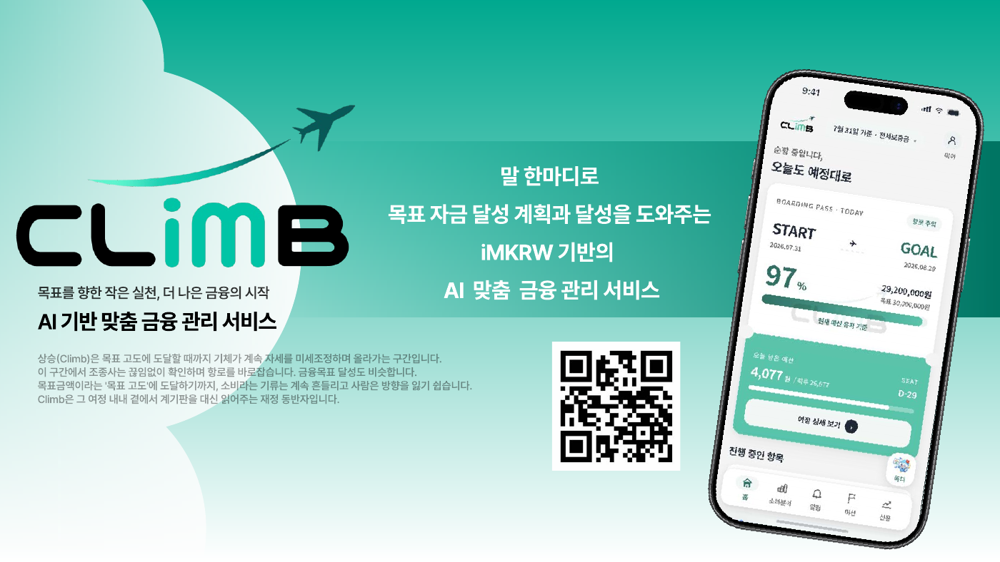
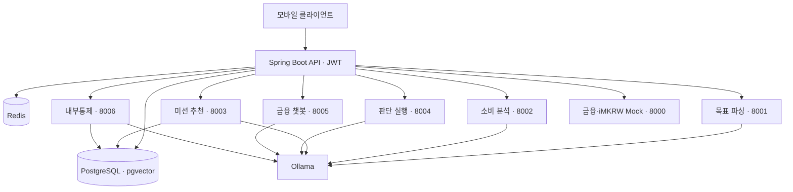

# CLiMB · iM-Goal

> 말 한마디로 시작하는 목표 자금 관리, 작은 실천으로 완성하는 금융 습관.



**CLiMB**는 사용자의 목표와 소비 패턴을 바탕으로 재무 계획을 세우고, 개인화된 절약 미션으로 목표 달성을 돕는 AI 금융 관리 서비스입니다.

“전세 보증금을 모으고 싶어”, “여행 자금을 마련하고 싶어”처럼 목표를 입력하면 소득과 지출에 맞는 하루 예산을 설계합니다. 이후 소비 변화를 감지하고 실천할 수 있는 미션을 제안해, 계획이 일상의 행동으로 이어지도록 돕습니다.

이 저장소는 CLiMB의 **Spring Boot 백엔드와 FastAPI 기반 AI 에이전트**를 관리합니다. 프로젝트 초기 명칭은 `iM AgentiX`이며, 코드와 모듈에서는 `agentic`을 사용합니다.

## 기획 배경

소비 내역을 보여주는 것만으로는 저축 목표를 달성하기 어렵습니다. 사용자는 자신의 재정 상황에 맞춰 얼마를 모으고, 오늘 무엇을 줄여야 하는지 구체적인 안내가 필요합니다.

CLiMB는 금융 관리에 익숙하지 않은 청년과 소비 습관을 바꾸고 싶은 사용자를 위해 **목표 설정 → 예산 설계 → 소비 분석 → 절약 미션 → 진행 상황 확인**을 하나의 흐름으로 연결합니다.

## 주요 기능

### 자연어 기반 목표 설계

- 자연어로 입력한 목표에서 목표 금액과 기간을 파악합니다.
- 월 소득·고정 지출·가처분소득을 바탕으로 저축 계획과 하루 가용 예산을 계산합니다.
- 목표별 진행률과 예상 달성 일정을 확인할 수 있습니다.

### 마이데이터 기반 소비 분석

- 카드 승인 내역을 수집하고 카테고리별 지출을 집계합니다.
- 최근 4주 평균 지출과 개인 재정 정보를 기준으로 과소비를 감지합니다.
- 소득분위와 가용금액을 반영해 개인화된 소비 분석을 제공합니다.

### 개인화 절약 미션

- 소비 패턴에 맞는 절약 미션을 RAG 기반으로 검색하고 추천합니다.
- 여러 검색 쿼리의 결과를 RRF로 결합해 미션 후보를 구성합니다.
- 미션 제안·수락·성공 판단과 만기 처리 흐름을 관리합니다.

### iMKRW 보증금 관리

- 미션 참여 시 보증금을 예치하고 성공·해지에 따른 반환 흐름을 관리합니다.
- iMKRW 발행·소각, 중도 해지, Buy-out 기능을 제공합니다.
- 금융·토큰·스마트 컨트랙트 연동은 FastAPI Mock 서버를 통해 시연합니다.

### AI 금융 챗봇과 재무 계획 보고서

- 사용자의 재정 정보·목표·미션 현황을 반영한 금융 챗봇을 제공합니다.
- 자산형성과 소비 목표에 맞춰 저축액·예산·계획 난이도를 정리합니다.
- 별도 내부통제 에이전트가 규정을 검색하고 저축 비율에 따른 위험 표시와 상담 권고를 반환하며, 결과를 감사 로그로 저장합니다.

### 대시보드와 시연 기능

- 목표 진행 상황, 소비 내역, 보증금과 주간 리포트를 확인할 수 있습니다.
- 결제·급여 입금·Buy-out·미션 만기 트리거로 주요 사용자 흐름을 시연할 수 있습니다.

## 서비스 흐름

```text
회원가입 및 로그인
    → 소득·고정 지출 등록 및 카드 내역 수집
    → 자연어 목표 입력
    → 저축 계획과 하루 예산 설계
    → 소비 분석 및 과소비 감지
    → 개인화 절약 미션 제안
    → 미션 수락 및 보증금 예치
    → 미션 결과와 목표 진행 상황 확인
```

## 시스템 아키텍처



Spring Boot가 인증과 비즈니스 로직을 처리하고, 사용자별 재정 정보를 DTO에 담아 각 에이전트로 전달합니다. AI 에이전트는 역할별 FastAPI 서비스로 구성하며, 로컬 Ollama에서 LLM 추론과 임베딩을 수행합니다.

## 기술 스택

| 영역 | 기술 |
|---|---|
| Backend | Java 21, Spring Boot 3.4.1, Spring Security, Spring Data JPA, WebClient, JWT |
| AI | Python 3.11+, FastAPI, Ollama, Qwen2.5 1.5B |
| RAG | nomic-embed-text, pgvector, 다중 쿼리 검색, RRF |
| Database | PostgreSQL 16, Redis 7 |
| Infra | Docker, Docker Compose, Gradle |

## 프로젝트 구조

```text
agentic-api/       REST API, 인증, 서비스, 요청·응답 DTO
agentic-common/    공통 예외 및 응답
agentic-domain/    도메인 엔티티 및 리포지토리
agentic-infra/     AI 에이전트·금융·블록체인 클라이언트
agents/
├── goal-parsing/  목표 파싱
├── spending/      소비 분석
├── mission/       RAG 기반 미션 추천
├── execution/     미션 판단 실행
├── chat/          금융 챗봇
└── compliance/    규정 검색 및 내부통제
fastapi-mock/     외부 금융·iMKRW·계약 Mock 서버
simulation/       금융 효과 시뮬레이션
scripts/          데이터 준비 및 규정 적재 도구
data/             데이터 및 규정 문서
results/          시뮬레이션 결과
docs/             서비스 소개 및 발표 자료
sql/              DB 초기화 스크립트
```

## 실행 방법

### 사전 준비

- Java 21
- Docker 및 Docker Compose
- Ollama
- Python 3.11+ (내부통제 에이전트 별도 실행 시)

```bash
ollama pull qwen2.5:1.5b
ollama pull nomic-embed-text
```

### 기본 환경 실행

```bash
git clone https://github.com/iM-Goal/BE.git
cd BE
docker compose up -d --build
```

PostgreSQL, Redis, Mock 서버와 AI 에이전트 5개가 실행됩니다. 백엔드는 Compose에 설정된 Docker 이미지를 사용하며, 에이전트는 `host.docker.internal:11434`로 호스트의 Ollama에 연결합니다.

현재 소스로 백엔드를 실행하려면 다음 명령을 사용합니다.

```bash
docker compose stop backend
SPRING_JPA_HIBERNATE_DDL_AUTO=update ./gradlew :agentic-api:bootRun
```

기본 JPA 설정은 데모용 `create-drop`입니다. 위 명령은 `update`로 재정의해 로컬 개발 데이터를 유지합니다.

### 내부통제 에이전트 실행

내부통제 에이전트는 기본 Compose 구성과 별도로 실행합니다.

```bash
python3 -m venv .venv
source .venv/bin/activate
python -m pip install -r agents/compliance/requirements.txt pypdf
DB_HOST=localhost uvicorn main:app --app-dir agents/compliance --host 127.0.0.1 --port 8006
```

규정 검색을 사용하려면 백엔드 실행 후 별도 터미널에서 스키마와 규정 문서를 적재합니다.

```bash
docker compose exec -T postgres psql -U agentic_user -d agentic < sql/compliance_schema.sql
# data/compliance/에 규정 문서를 추가한 뒤 실행
python scripts/ingest_compliance.py
```

### 주요 환경변수

| 변수 | 설명 |
|---|---|
| `DB_HOST`, `DB_PORT`, `DB_NAME` | DB 주소, 포트, 데이터베이스명 |
| `DB_USERNAME`, `DB_PASSWORD` | Spring Boot DB 계정 |
| `DB_USER`, `DB_PASS` | Python 에이전트 DB 계정 |
| `REDIS_HOST`, `REDIS_PORT` | Redis 연결 정보 |
| `OLLAMA_BASE_URL`, `OLLAMA_MODEL` | Ollama 주소 및 모델 |
| `AGENT_GOAL_PARSING_URL`, `AGENT_SPENDING_URL`, `AGENT_MISSION_URL`, `AGENT_EXECUTION_URL`, `AGENT_CHAT_URL` | 백엔드에서 호출하는 에이전트 주소 |
| `AGENT_COMPLIANCE_URL` | 내부통제 에이전트 주소. 기본 `http://localhost:8006` |

## API 문서

| 서비스 | 주소 |
|---|---|
| Backend Swagger | [localhost:8080/swagger-ui.html](http://localhost:8080/swagger-ui.html) |
| 금융 Mock | [localhost:8000/docs](http://localhost:8000/docs) |
| 목표 파싱 | [localhost:8001/docs](http://localhost:8001/docs) |
| 소비 분석 | [localhost:8002/docs](http://localhost:8002/docs) |
| 미션 추천 | [localhost:8003/docs](http://localhost:8003/docs) |
| 판단 실행 | [localhost:8004/docs](http://localhost:8004/docs) |
| 금융 챗봇 | [localhost:8005/docs](http://localhost:8005/docs) |
| 내부통제 | [localhost:8006/docs](http://localhost:8006/docs) |

로그인 후 발급받은 JWT를 Swagger의 `Authorize`에 입력해 인증이 필요한 API를 호출할 수 있습니다.
